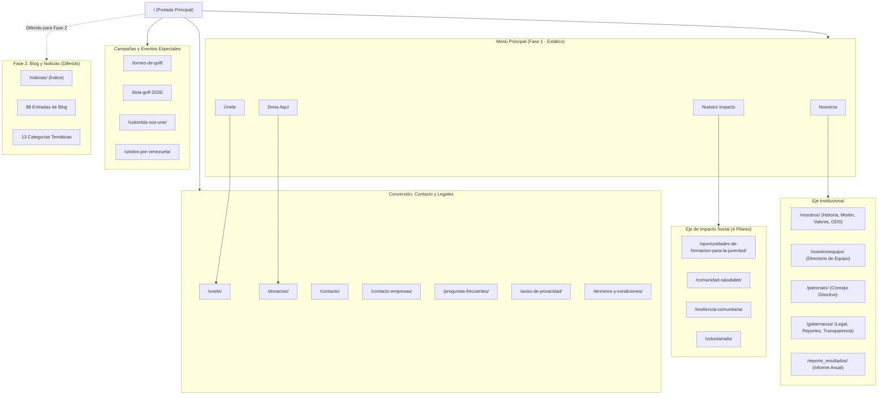
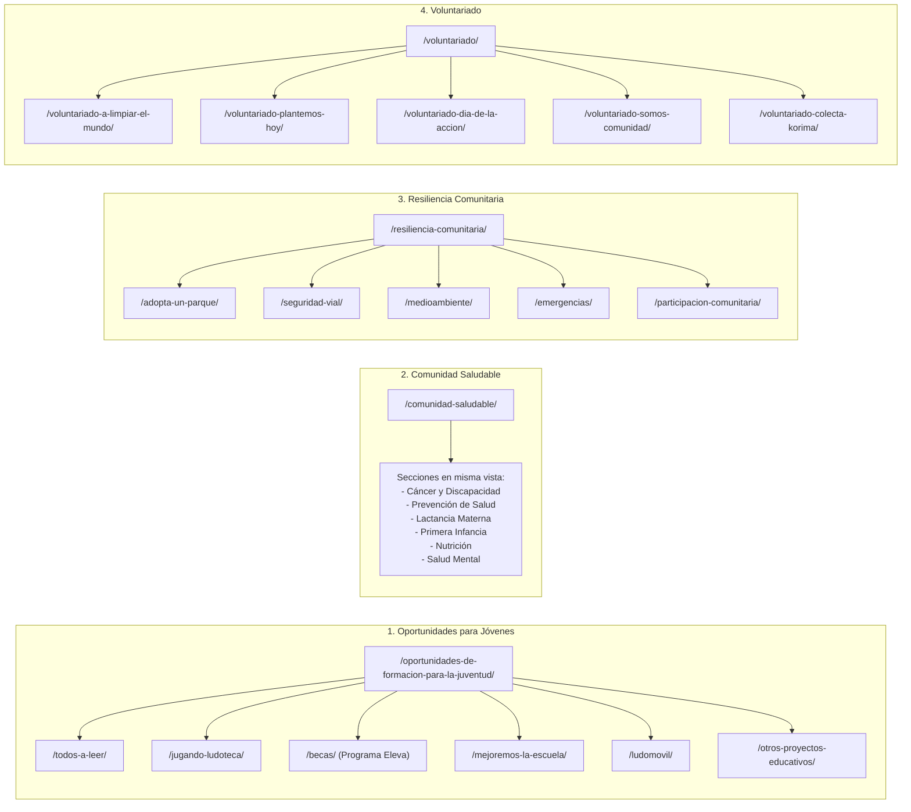

# Mapa del Sitio e Inventario de Arquitectura: `uwchihuahua.org`

Este documento describe la arquitectura de información completa del sitio web de **United Way Chihuahua** (`https://uwchihuahua.org/`), diferenciando el **Sitio Estático (Fase 1 - Objetivo Actual)** de la **Dinámica de Blog / Noticias (Fase 2 - Post-Entrega)**, e identificando fallos de enrutamiento 404 y páginas huérfanas en el sitio en producción.

---

## 1. Diagrama de Navegación Global (Fase 1 vs. Fase 2)

---

## 2. Los 4 Pilares de Impacto Social y sus 16 Subprogramas

---

## 3. Inventario Completo de Páginas Estáticas Activas (Fase 1 - 34 Páginas)

### A. Portada y Eje Institucional (6 URLs)
1. `/`: Portada institucional, contadores de métricas, carrusel de socios corporativos, accesos rápidos a pilares.
2. `/nosotros/` (y `/nosotros-institucion/`): Misión, visión 2027, valores organizacionales, historia, modelo de operación y ODS.
3. `/nosotrosequipo/`: Organigrama operativo (Dirección Ejecutiva, Inversión Social, Administración, Cultura Filantrópica, Comunicación, Relaciones Institucionales, Engagement).
4. `/patronato/`: Directorio del Consejo Directivo (11 consejeros de empresas líderes como Lear, Bosch, Ernst & Young, Rubio Villegas, Hágalo).
5. `/gobernanza/`: Estatus legal como Donataria Autorizada SAT, aval para donaciones extranjeras, reportes financieros anuales auditados y códigos de ética.
6. `/reporte_resultados/`: Descarga y visor del Informe Anual de Resultados de United Way Chihuahua.

### B. Eje de Impacto Social (20 URLs)
7. `/nuestro-impacto/`: Portal introductorio a las 4 áreas de enfoque social.
8. `/oportunidades-de-formacion-para-la-juventud/`: Hub del pilar de educación y juventud.
9. `/todos-a-leer/`: Programa de fomento a la lectura en escuelas primarias.
10. `/jugando-ludoteca/`: Espacios lúdicos educativos (Ludotecas en planteles).
11. `/becas/`: Programa de Becas Eleva para educación media superior y superior.
12. `/mejoremos-la-escuela/`: Rehabilitación e infraestructura escolar digna.
13. `/ludomovil/`: Unidad móvil itinerante con dinámicas educativas para colonias vulnerables.
14. `/otros-proyectos-educativos/`: Proyectos complementarios STEAM, fortalecimiento docente y mejora continua.
15. `/comunidad-saludable/`: Hub de salud integral (cáncer, lactancia, primera infancia, salud mental).
16. `/resiliencia-comunitaria/`: Hub del pilar de fortalecimiento del entorno urbano y comunitario.
17. `/adopta-un-parque/`: Rescate y adopción de áreas verdes y espacios públicos vecinales.
18. `/seguridad-vial/`: Capacitación y adecuaciones de entornos seguros para peatones y escolares.
19. `/medioambiente/`: Iniciativas ecológicas, reciclaje y cuidado de recursos naturales.
20. `/emergencias/`: Fondo de contingencia y auxilio ante desastres naturales.
21. `/participacion-comunitaria/`: Comités de vecinos y empoderamiento ciudadano.
22. `/voluntariado/`: Hub de la red de voluntarios corporativos y comunitarios.
23. `/voluntariado-a-limpiar-el-mundo/`: Jornadas masivas de saneamiento y limpieza ambiental.
24. `/voluntariado-plantemos-hoy/`: Campañas masivas de reforestación urbana.
25. `/voluntariado-dia-de-la-accion/`: Mega jornada anual con servicios médicos gratuitos y talleres STEAM.
26. `/voluntariado-somos-comunidad/`: Intervenciones comunitarias integrales de fin de año.
27. `/voluntariado-colecta-korima/`: Colecta anual de víveres, cobijas y abrigo para zonas serranas y vulnerables.

### C. Conversión, Contacto y Soporte (4 URLs)
28. `/unete/`: Landing para personas y empresas interesadas en sumarse a la causa.
29. `/donacion/`: Pasarela e información para aportaciones únicas o recurrentes (Givecloud / transferencias BBVA).
30. `/contacto/`: Datos de contacto general (dirección, teléfonos, horario, formulario).
31. `/contacto-empresas/`: Formulario y propuesta de valor para socios corporativos y responsabilidad social empresarial.
32. `/preguntas-frecuentes/`: Acordeón interactivo con dudas sobre donaciones, deducibilidad y voluntariado.

### D. Políticas y Legales (2 URLs)
33. `/aviso-de-privacidad/`: Cumplimiento regulatorio del manejo de datos personales (LFPDPPP).
34. `/terminos-y-condiciones/`: Términos de uso del sitio web y condiciones de donativos.

---

## 4. Campañas Especiales / Eventos Estacionales (4 URLs)

Estas vistas tienen una estructura propia pero forman parte del catálogo estático:
1. `/torneo-de-golf/`: Landing oficial del **7° Torneo de Golf United Way Chihuahua**, con información del evento, datos bancarios BBVA y llamado a patrocinadores.
2. `/lista-golf-2026/`: Tabla de participantes inscritos (actualmente renderizada con wpDataTables/TablePress).
3. `/colombia-nos-une/`: Campaña humanitaria de emergencia internacional con opciones de donación.
4. `/unidos-por-venezuela/`: Campaña humanitaria con opciones de apoyo financiero.

---

## 5. Auditoría Crítica: Enlaces 404 Detectados en el Sitio en Vivo

En la portada actual (`https://uwchihuahua.org/`) y en `/nuestro-impacto/`, los siguientes botones clave generan un error **HTTP 404 Not Found**:

| Ubicación en Pantalla | Texto del Botón / Tarjeta | URL Rota en WordPress (404) | URL Destino Correcta Propuesta |
| :--- | :--- | :--- | :--- |
| **Hero / Sección Media de Home** | `¿CÓMO PUEDES AYUDAR?` | `https://uwchihuahua.org/como-puedes-ayudar/` | `/unete/` |
| **Tarjetas "Nuestro Impacto" (Home e Impacto)** | `Comunidades saludables` | `https://uwchihuahua.org/comunidad-saludable-2/` | `/comunidad-saludable/` |
| **Tarjetas "Nuestro Impacto" (Home e Impacto)** | `Resiliencia comunitaria` | `https://uwchihuahua.org/resiliencia-comunitaria-2/` | `/resiliencia-comunitaria/` |
| **Tarjetas "Nuestro Impacto" (Home e Impacto)** | `Voluntariado` | `https://uwchihuahua.org/voluntariado-2/` | `/voluntariado/` |

---

## 6. Páginas Huérfanas y Borradores a Depurar (19 URLs)

Detectadas en `page-sitemap.xml` con fecha de 2024-2025; no forman parte de la navegación oficial y representan contaminación de indexación en Google:
- `/sample-page/` (Página de prueba predeterminada de WordPress)
- `/para-recuperar/` (Borrador interno)
- `/asociate-con-nosotros/`, `/nuestros-socios/`, `/beneficios-de-participar/`
- `/satisfacer-las-necesidades-locales-con-un-impacto-global/`
- `/encuentre-su-united-way-local/`
- `/por-que-donar/`, `/por-que-ser-voluntario/`
- `/hablar-claro/`, `/mantente-informado/`, `/involucrate/`
- `/nuestra-mision-valores/`, `/nuestro-enfoque/`, `/voluntario/`
- `/empresas/`, `/donantes-individuales/`, `/voluntario-registro/`

---

## 7. Módulo de Noticias / Blog (Fase 2 - Post-Entrega Estática)

El ecosistema dinámico de noticias se reserva para la segunda fase:
- **Índice General:** `/noticias/`
- **Total de Artículos:** 88 entradas de noticias publicadas desde 2024 a 2026.
- **Categorías Temáticas (13):**
  - `35 Años`, `Aniversario`, `Comunidades Saludables`, `Convocatoria de Proyectos`, `Eleva`, `Estabilidad Financiera`, `Institucional`, `Ludoteca`, `Oportunidades para los más jóvenes`, `Resiliencia Comunitaria`, `Todos a Leer`, `Voluntariado`, `Uncategorized`.
