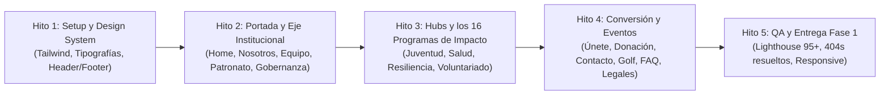

# Diagnóstico Técnico y Propuesta de Arquitectura: United Way Chihuahua

Este documento consolida el diagnóstico técnico del sitio web actual (`https://uwchihuahua.org/`), identifica las oportunidades críticas de mejora y formula la propuesta arquitectónica y comercial para la clonación y modernización en **Fase 1 (Sitio Estático)** y **Fase 2 (Blog / Noticias)**.

---

## 1. Diagnóstico Técnico del Sitio Actual (Hallazgos y Argumentos de Valor)

Tras la auditoría exhaustiva realizada sobre el código fuente, las hojas de estilo y los sitemaps de `uwchihuahua.org`, se detectaron 4 problemas graves en producción:

### A. Enlaces Críticos Rotos (Error HTTP 404 en Portada)
Los botones de mayor intención de usuario en la página principal devuelven actualmente un error 404 debido a slugs desactualizados en WordPress:
1. **Botón Principal de Conversión**: El botón `¿CÓMO PUEDES AYUDAR?` en el Hero enlaza a `/como-puedes-ayudar/` (**404 Not Found** en lugar de `/unete/`).
2. **Navegación de Pilares de Impacto**:
   - `Comunidades saludables` apunta a `/comunidad-saludable-2/` (**404 Not Found**).
   - `Resiliencia comunitaria` apunta a `/resiliencia-comunitaria-2/` (**404 Not Found**).
   - `Voluntariado` apunta a `/voluntariado-2/` (**404 Not Found**).
*Impacto*: Pérdida directa de donantes potenciales y visitantes interesados en conocer los programas sociales.

### B. Sobrecarga de DOM y Duplicación Móvil / Escritorio
- Elementor genera **dos versiones completas de cada sección** (una con clase `.elementor-hidden-desktop` y otra con `.elementor-hidden-mobile`).
- Esto **duplica los encabezados `H2` y `H3` en el DOM** (perjudicando la accesibilidad y el SEO semántico) y genera un peso HTML inicial superior a **258 KB** solo en texto plano, sin contar imágenes.

### C. Dependencia Masiva de Plugins de WordPress
Para desplegar un sitio que en un 95% es de contenido estático institucional, la instalación actual depende de más de 15 plugins simultáneos:
- *Elementor + Elementor Pro*
- *Jeg Elementor Kit* (con sliders externos TinySlider)
- *JetEngine*
- *MetForm* (con CuteAlert)
- *wpDataTables / TablePress*
- *GiveWP* (donaciones)
- *Essential Addons for Elementor*
- *Yoast SEO*
*Impacto*: Múltiples peticiones HTTP bloqueantes (>30 hojas CSS independientes), vulnerabilidades continuas por falta de parches en plugins y tiempos de carga lentos en conexiones móviles.

### D. Contaminación en el Sitemap Indexado
El archivo `page-sitemap.xml` contiene **71 URLs**, de las cuales casi un tercio son **páginas huérfanas, de prueba o borradores abandonados** (ej. `/sample-page/`, `/para-recuperar/`, slugs de 2024).

---

## 2. Propuesta de Solución en 2 Fases

Para maximizar la velocidad de entrega y garantizar un resultado impecable, se plantea dividir el proyecto en dos fases:

```
┌────────────────────────────────────────────────────────┐
│  FASE 1: SITIO ESTÁTICO DE ALTO RENDIMIENTO (ACTUAL)   │
│  - 34 Páginas Activas + 4 Campañas Especiales         │
│  - 14 Componentes Reutilizables en TypeScript          │
│  - Contenido centralizado en datos tipados (data/*.ts) │
│  - Enlaces 404 100% corregidos                        │
│  - Lighthouse Score 95-100 en Performance y SEO       │
│  - Tiempo de entrega rápido y sin fricción de backend  │
└────────────────────────────────────────────────────────┘
                           │
                           ▼
┌────────────────────────────────────────────────────────┐
│  FASE 2: MÓDULO DINÁMICO DE BLOG Y NOTICIAS (POST)     │
│  - Migración de las 88 entradas de noticias            │
│  - Taxonomía de las 13 categorías temáticas            │
│  - Integración vía Headless CMS o API REST ligera      │
│  - Panel de administración para publicación continua   │
└────────────────────────────────────────────────────────┘
```

---

## 3. Arquitectura Técnica de Fase 1 (Sitio Estático)

### Modelo de Componentes y Datos Desacoplados
En lugar de crear 34 archivos HTML monolíticos o páginas duplicadas, se utiliza una **arquitectura basada en datos tipados**:

```
src/
├── components/          # 14 componentes UI reutilizables
│   ├── layout/          # HeaderNav, Footer, TopBar
│   ├── impact/          # KpiGrid, ImpactCard, ProgramTemplate
│   ├── common/          # Button, Accordion, Modal
│   └── forms/           # ContactForm, NewsletterForm
├── data/                # Fuente local de la verdad (Tipada)
│   ├── siteConfig.ts    # Teléfonos, redes sociales, enlaces
│   ├── navigation.ts    # Estructura del menú y footer
│   ├── kpis.ts          # Métricas de impacto (+7,992,087, etc.)
│   ├── partners.ts      # Lista de 30+ empresas patrocinadoras
│   ├── team.ts          # Directora + 6 áreas operativas
│   ├── board.ts         # 11 Miembros del Consejo Directivo
│   ├── programs/        # Datos estructurados de los 16 programas
│   │   ├── juventud.ts
│   │   ├── salud.ts
│   │   ├── resiliencia.ts
│   │   └── voluntariado.ts
│   └── faq.ts           # Preguntas y respuestas
└── pages/               # Vistas principales del enrutador
```

### Ventajas de este Modelo para el Cliente:
1. **Actualización Sin Tocar Código Visual**: Cambiar un miembro del patronato, una métrica de impacto o los datos de un programa se hace editando un simple archivo de datos limpio en `src/data/`, sin riesgo de romper el diseño visual.
2. **Cero Duplicación de Código**: Las 16 subpáginas de programas sociales se renderizan a través de un único componente `ProgramTemplate`, garantizando consistencia absoluta en diseño y facilidad de mantenimiento.
3. **Cero Enlaces Rotos**: El enrutador centralizado asegura que ningún botón quede apuntando a URLs inexistentes o con errores 404.

---

## 4. Comparativa de Opciones de Stack para la Propuesta

| Criterio | Opción A: React + TypeScript + Vite | Opción B: Astro + TypeScript + Tailwind |
| :--- | :--- | :--- |
| **Alineación con Dataholics** | Nativa (Estándar del protocolo `/scaffold-desarrollo-agil`) | Excelente para sitios puramente de contenido |
| **Rendimiento de Carga** | < 1.2 segundos (SPA optimizada con Lazy Loading) | < 0.6 segundos (HTML estático con Zero JS por defecto) |
| **SEO y Metadatos** | Configurable vía React Helmet / pre-render | SEO nativo fuera de la caja en cada archivo `.astro` |
| **Facilidad de Extensión a Fase 2** | Sencilla para conectar con APIs REST / Backend | Sencilla para conectar con colecciones de contenido Markdown/CMS |
| **Recomendación** | **Recomendada** si se busca interactividad fluida y continuidad con el estándar de aplicaciones de Dataholics | **Alternativa ideal** si el cliente prioriza SEO estático puro y cero Javascript |

---

## 5. Plan de Ejecución Propuesto (Cronograma por Hitos)



- **Hito 1: Cimientos y Sistema Visual**: Configuración de tokens de color, fuentes locales (`Antonio`, `Nunito Sans`, `Palanquin`), `HeaderNav` responsivo y `Footer`.
- **Hito 2: Portada y Núcleo Institucional**: Maquetación de la Home (Hero, contadores de impacto animados, carrusel de socios corporativos) y páginas de `/nosotros/`, `/nosotrosequipo/`, `/patronato/`, `/gobernanza/` y `/reporte_resultados/`.
- **Hito 3: Los 4 Pilares de Impacto y sus 16 Programas**: Implementación de la plantilla universal `ProgramTemplate` y carga de datos para Juventud, Salud, Resiliencia y Voluntariado.
- **Hito 4: Conversión, Campañas y Soporte**: Vistas de `/unete/`, pasarela y datos bancarios en `/donacion/`, formularios de `/contacto/` y `/contacto-empresas/`, `/torneo-de-golf/`, `/lista-golf-2026/`, `/preguntas-frecuentes/` y legales.
- **Hito 5: Auditoría, Compuerta de Calidad y Entrega**: Ejecución de `verificar.ps1`, pruebas responsivas y preparación de la propuesta de Fase 2.
