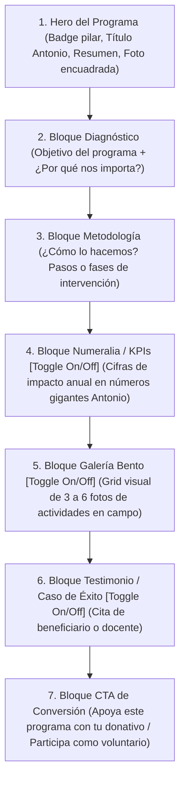

# Especificación de Arquitectura UX/UI y Sistema de Plantillas Modulares

**Proyecto**: Clonación y Modernización de United Way Chihuahua (`uwchihuahua.org`)  
**Especialidad**: Diseño de Experiencia de Usuario (UX), Interfaz Gráfica (UI) y Sistema de Componentes  
**Referencias Oficiales**: 
- `uwchihuahua.org` (Auditoría en vivo y tokens de `post-8.css`)
- `tuw.org` (*Trident United Way*)
- `berkshireunitedway.org` (*Berkshire United Way*)
- `unitedway.org` (*United Way Worldwide*)

---

## 1. Fundamentos Visuales y Tokens de Diseño

La interfaz gráfica implementa los tokens extraídos directamente del archivo de diseño en producción (`post-8.css`), garantizando fidelidad 100% a la marca internacional de United Way con acento local en Chihuahua:

```css
:root {
  /* Colores Principales */
  --uw-primary-navy: #21296B;       /* Navy institucional profundo */
  --uw-royal-blue: #0044B5;         /* Azul vibrante de acción */
  --uw-sky-accent: #A7D2FF;         /* Azul cielo de soporte */
  --uw-surface-cream: #EDE8DA;      /* Crema de fondos secundarios */
  
  /* Llamados a la Acción y Donación */
  --uw-action-red: #FD372C;         /* Rojo primario de donación */
  --uw-action-red-hover: #D12626;   /* Hover oscuro de botones rojos */
  
  /* Pilares Temáticos Oficiales */
  --pillar-jovenes: #FFBA00;        /* Amarillo Educación / Becas */
  --pillar-salud: #0044B5;          /* Azul Comunidad Saludable */
  --pillar-resiliencia: #F47925;    /* Naranja Resiliencia y Emergencias */
  --pillar-voluntariado: #009464;   /* Verde Voluntariado / Finanzas (#6C76D3 morado acento) */

  /* Tipografías */
  --font-display: 'Antonio', sans-serif;         /* Titulares de impacto y cifras de KPIs */
  --font-heading: 'Nunito Sans', sans-serif;     /* Subtítulos, navegación y botones */
  --font-body: 'Palanquin', 'Nunito Sans', sans-serif; /* Texto corrido y lectura institucional */
}
```

---

## 2. Anatomía de los 6 Componentes y Plantillas Clave

### 2.1. Componente 1: Sticky Header Persistente y Mega-Dropdown de Impacto
- **Objetivo**: Resolver la navegación rígida del sitio anterior, manteniendo el acceso a las causas y la llamada de donación accesible durante toda la visita.
- **Estructura en 2 Niveles**:
  1. **Top Bar Superior (Desktop)**: Altura `36px`. Fondo `#21296B`. Texto en blanco 12px. Muestra: *"Chihuahua, Chih., México"* | Redes sociales institucionales (Facebook, Instagram, LinkedIn, YouTube) | Enlace a Teléfono / Contacto directo.
  2. **Barra de Navegación Principal (Sticky)**:
     - Estado normal: Altura `88px`, fondo blanco puro (`#FFFFFF`).
     - Estado scroll (`scrollY > 80px`): Altura reducida a `68px`, fondo `rgba(255, 255, 255, 0.96)`, soporte para `backdrop-filter: blur(10px)` y sombra `0 4px 20px rgba(33, 41, 107, 0.08)`.
- **Estructura del Menú**:
  - `Nosotros` (Historia, Visión 2027, Consejo Directivo, Transparencia e Informes Anuales).
  - `Nuestro Impacto` (**Mega-Dropdown interactivo**): Despliega en 4 columnas los 4 pilares con sus 16 programas hijos, resolviendo de origen los 4 errores `404` del sitio actual.
  - `Empresas` (RSE, Inversión Social, Voluntariado Corporativo).
  - `Únete` (Donación individual, Voluntariado comunitario, Colectas anuales).
  - `Noticias` (Acceso al blog desacoplado).
  - **Botón Primario Destacado**: `DONA AQUÍ` en color `#FD372C` con texto mayúsculas, tracking `3px` y transición de hover a `#D12626`.

---

### 2.2. Componente 2: Hero Rotor Dinámico con Máscara Gráfica y Selector de Pestañas
- **Objetivo**: Eliminar definitivamente los banners horizontales gigantes apilados que saturaban el Home actual, integrando hasta 4 diapositivas dinámicas con rotación automática y control manual.
- **Inspiración Técnica**: Componente `front-page-rotor-banner` de *Berkshire United Way* (`berkshireunitedway.org`) y *Trident United Way* (`tuw.org`).
- **Anatomía del Slide**:
  - **Lado Izquierdo (45% ancho) — Máscara Gráfica Institucional**:
    - Contenedor con corte curvo/diagonal institucional o degradado sólido en Azul Marino `#21296B` o Azul Rey `#0044B5`.
    - Garantiza **contraste WCAG AAA (13.8:1)** para el texto sin depender de la claridad u oscuridad de la fotografía de fondo.
    - Contiene: Etiqueta de Campaña / Evento (ej. `CONVOCATORIA ABIERTA`, `TORNEO DE GOLF 2026`, `EMERGENCIA HUMANITARIA`), Titular en `Antonio` Bold (H1/H2), resumen de 2 líneas y botón primario de acción (ej. `REGÍSTRATE AQUÍ` o `DONA AHORA`).
  - **Lado Derecho (55% ancho) — Zona Fotográfica con Encuadre Inteligente**:
    - Imagen de alta resolución cargada con `aspect-ratio: 16/9` (mínimo `540px` de altura).
    - Propiedad CSS `object-fit: cover` con anclaje `object-position: center 25%` (o selector editable en datos) para asegurar que los rostros de niños y voluntarios jamás queden mutilados ni tapados por textos.
- **Barra de Pestañas Inferior (`Rotor Controls`)**:
  - Ubicada en la base del slider en desktop. Muestra hasta 4 pestañas interactivas con el nombre o número del evento:
    - `01. Torneo de Golf 2026`
    - `02. Colombia Nos Une`
    - `03. Visión 2027: Impacto Chihuahua`
    - `04. Voluntariado Corporativo`
  - Incluye barra de progreso sutil (tiempo de slide: 6 segundos) que se pausa automáticamente al colocar el cursor encima (`:hover` / `:focus`).

---

### 2.3. Componente 3: Grid de 4 Pilares de Impacto ("Con Sal y Pimienta")
- **Objetivo**: Transformar el bloque plano de causas del sitio original en una grilla interactiva de 4 tarjetas representativas, visuales y dinámicas.
- **Estructura de Tarjeta (4 columnas desktop, carrusel/stack móvil)**:
  1. **Fotografía Superior (`aspect-ratio: 4/3`, altura `220px`)**:
     - Fotografía representativa del pilar tomada en campo en Chihuahua.
     - Efecto hover: Zoom suave `scale(1.05)` con `transition: transform 300ms ease`.
  2. **Badge Circular del Pilar (Traslape flotante)**:
     - Ícono oficial en vector SVG con fondo del color temático (`#FFBA00` Jóvenes, `#0044B5` Salud, `#F47925` Resiliencia, `#009464` Voluntariado).
     - Posicionado flotando en la frontera entre la foto y el contenido.
  3. **Caja de Contenido de la Tarjeta**:
     - Borde superior de acento con el color del pilar (3px).
     - Título del Pilar en tipografía `Antonio` (H3, 22px).
     - Breve descripción del impacto en la comunidad (2 a 3 líneas en `Palanquin`).
     - Micro-etiquetas de programas clave (ej. `+5 programas`, `Robótica`, `Kórima`).
     - Enlace de llamada con flecha animada: `Explorar programas →`.
  4. **Micro-interacción al Hover**:
     - Elevación de tarjeta (`transform: translateY(-6px)`), sombra suave (`0 12px 30px rgba(33, 41, 107, 0.12)`).

---

### 2.4. Componente 4: Sección de Alianzas Corporativas y RSE
- **Objetivo**: Brindar a las empresas de Chihuahua y la región un portal persuasivo para sumarse como donantes corporativos o aliados estratégicos (resolviendo la queja de Elliott sobre la sección *"toda X"* de `/unete/`).
- **Anatomía de la Sección**:
  - **Encabezado Institucional**: Titular de impacto en `Antonio`: *"TRANSFORMA TU EMPRESA EN UN MOTOR DE IMPACTO SOCIAL"*.
  - **3 Ejes de Participación Corporativa**:
    1. **Inversión Social Estratégica**: Proyectos de alto impacto con deducibilidad de impuestos al 100%, trazabilidad y reportes de rendición de cuentas.
    2. **Voluntariado Corporativo con Propósito**: Jornadas de integración para colaboradores (rehabilitación de escuelas, reforestación de parques comunitarios, mentorías juveniles).
    3. **Campaña de Donación por Nómina (*Workplace Giving*)**: Cultura de donación recurrente donde los empleados aportan voluntariamente y la empresa puede realizar esquema de *matching funds* (duplicar donativos).
  - **Muro de Confianza**: Carrusel de logos de empresas e industrias aliadas de Chihuahua.
  - **Llamado a la Acción B2B**: Botón `Agenda una alianza con tu empresa` que abre un formulario específico para ejecutivos y áreas de recursos humanos / sustentabilidad.

---

### 2.5. Plantilla Maestra A: Subpágina Modular de Programa (16 Subprogramas)
- **Objetivo**: Terminar con la inconsistencia y desigualdad que el proveedor anterior dejó entre las 16 subpáginas de programas sociales.
- **Estructura Data-Driven en Bloques Desacoplados (con `toggles` en configuración)**:



- **Ejemplo de Configuración de Datos para Cada Programa (`src/data/programas.ts`)**:
```typescript
export interface ProgramaConfig {
  slug: string;
  pilar: 'jovenes' | 'salud' | 'resiliencia' | 'voluntariado';
  titulo: string;
  resumen: string;
  heroImage: string;
  objetivo: string;
  justificacion: string;
  metodologia: Array<{ paso: number; titulo: string; descripcion: string }>;
  kpis?: Array<{ valor: string; etiqueta: string }>; // Toggle condicional
  galeria?: string[];                                // Toggle condicional
  aliados?: string[];                                // Toggle condicional
  ctaGivecloudUrl?: string;
}
```

---

### 2.6. Plantilla Maestra B: Campaña de Emergencia y Evento Especial (`Givecloud Embed`)
- **Objetivo**: Permitir a Elliott crear y publicar en minutos una página de recaudación de fondos para emergencias (*ej. Colombia Nos Une, Incendios, Sequía*) o eventos masivos (*Torneo de Golf*), sin depender de desarrolladores ni maquetadores complejos.
- **Layout Split-Screen en Desktop**:
  - **Columna Izquierda (Narrativa de Urgencia — 60% de ancho)**:
    - Imagen o video emotivo de la causa.
    - Explicación clara: ¿Cuál es la emergencia?, ¿Hacia dónde van los recursos recaudados?, ¿Cómo se auditan los fondos?
    - Preguntas frecuentes rápidas de la campaña (deducibilidad, métodos de pago, transparencia).
  - **Columna Derecha (Slot Fijo Sticky — 40% de ancho)**:
    - Tarjeta flotante con sombra donde se incrusta de forma limpia y segura el código `<script>` o `<iframe>` proporcionado por **Givecloud** (`unitedwaychihuahua.givecloud.co`).
    - En caso de eventos como el *Torneo de Golf*, el slot muestra los paquetes de patrocinio, costo por jugador y formulario de inscripción directa.

---

## 3. Matriz de Corrección de Enlaces Rotos (404) de Producción

| URL Rota Detectada en `uwchihuahua.org` | Texto del Botón / Tarjeta Original | Destino Corregido en la Nueva Arquitectura |
| :--- | :--- | :--- |
| `https://uwchihuahua.org/como-puedes-ayudar/` | `¿CÓMO PUEDES AYUDAR?` | `/unete/` |
| `https://uwchihuahua.org/comunidad-saludable-2/` | Tarjeta *Comunidades saludables* | `/comunidad-saludable/` |
| `https://uwchihuahua.org/resiliencia-comunitaria-2/` | Tarjeta *Resiliencia comunitaria* | `/resiliencia-comunitaria/` |
| `https://uwchihuahua.org/voluntariado-2/` | Tarjeta *Voluntariado* | `/voluntariado/` |
