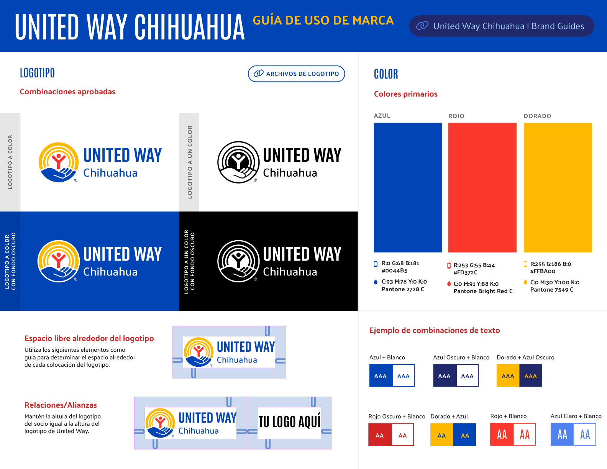
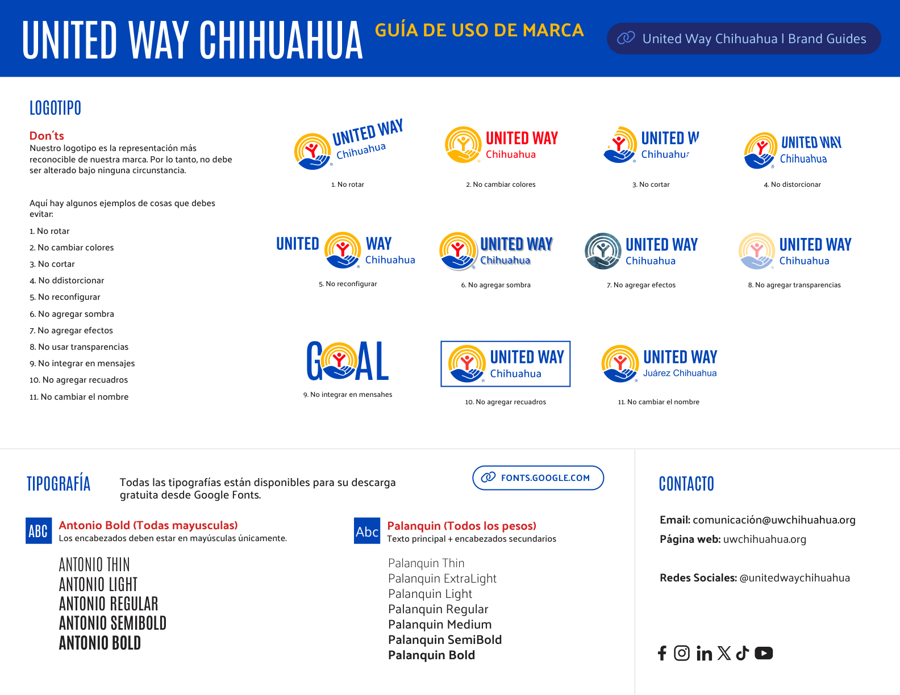
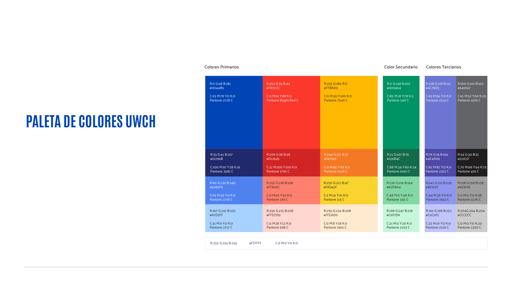
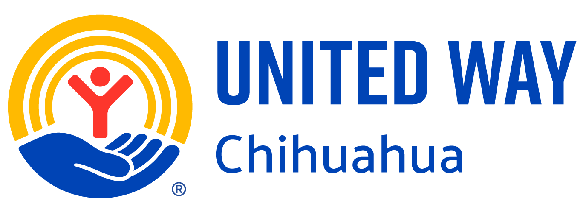
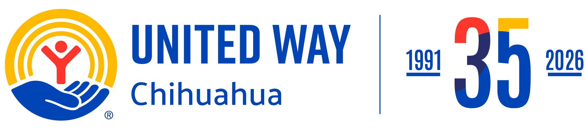

# 📘 Manual de Identidad Visual y Sistema de Diseño — United Way Chihuahua

> **Documento Oficial de Consulta Técnica para Agentes de Desarrollo y Humanos**  
> **Organización**: United Way Chihuahua / Fondo Unido Chihuahua  
> **Gobernanza**: Dataholics ServiceDesk & Engineering Core  
> **Versión**: 2026.1 (Basado en *United Way Worldwide Brand Guidelines v1.4* y *Guía Local UWCH*)  
> **Ruta base de assets**: [`x:\Dataholics-produccion\Agente-tickets\docs\marca\united-way\assets\`](file:///x:/Dataholics-produccion/Agente-tickets/docs/marca/united-way/assets/)  
> **Ruta base de PDFs oficiales**: [`x:\Dataholics-produccion\Agente-tickets\docs\marca\united-way\pdf\`](file:///x:/Dataholics-produccion/Agente-tickets/docs/marca/united-way/pdf/)

---

## 📑 Índice de Navegación Rápida
1. [Láminas Oficiales de Marca (Guías Visuales)](#1-láminas-oficiales-de-marca-guías-visuales)
2. [Catálogo de Assets e Imágenes Locales Disponibles](#2-catálogo-de-assets-e-imágenes-locales-disponibles)
3. [Identidad Nuclear del Logotipo (*Circle of Hope*)](#3-identidad-nuclear-del-logotipo-circle-of-hope)
4. [Área de Seguridad, Proporciones y Dimensiones Mínimas](#4-área-de-seguridad-proporciones-y-dimensiones-mínimas)
5. [Reglas Prohibitivas Estrictas del Logotipo (Don'ts)](#5-reglas-prohibitivas-estrictas-del-logotipo-donts)
6. [Sistema Cromático Completo (Pantone, HEX, RGB, CMYK)](#6-sistema-cromático-completo-pantone-hex-rgb-cmyk)
7. [Tokens Oficiales de Código (Tailwind CSS v4 & CSS Variables)](#7-tokens-oficiales-de-código-tailwind-css-v4--css-variables)
8. [Matriz de Accesibilidad y Contraste WCAG 2.1 (Nivel AA / AAA)](#8-matriz-de-accesibilidad-y-contraste-wcag-21-nivel-aa--aaa)
9. [Sistema Tipográfico Institucional (Google Fonts)](#9-sistema-tipográfico-institucional-google-fonts)
10. [Iconografía, Formas Geométricas y Tratamiento Fotográfico](#10-iconografía-formas-geométricas-y-tratamiento-fotográfico)
11. [Reglas de Co-Branding y Relaciones de Alianza](#11-reglas-de-co-branding-y-relaciones-de-alianza)
12. [Matriz de Ruteo de Tickets en Dataholics Resolve (5 Nodos)](#12-matriz-de-ruteo-de-tickets-en-dataholics-resolve-5-nodos)

---

## 1. Láminas Oficiales de Marca (Guías Visuales)

Estas láminas resumen las directrices aprobadas por la Dirección de Comunicación de United Way Chihuahua:

### Lámina 1: Logotipos, Espacio Libre y Colores Primarios

*Archivo original:* [`UWCH_Guia_de_uso_de_marca.pdf`](file:///x:/Dataholics-produccion/Agente-tickets/docs/marca/united-way/pdf/UWCH_Guia_de_uso_de_marca.pdf)

### Lámina 2: Don'ts Prohibitivos, Tipografía y Contactos

*Contacto institucional de marca*: Sara Romero (Directora de Marketing) y Nancy Fernández (Coordinadora de Comunicación) — `comunicación@uwchihuahua.org`.

### Lámina 3: Matriz Cromática Completa (20 Muestras)

*Archivo original:* [`Paleta_de_Colores_completa_UWCH.pdf`](file:///x:/Dataholics-produccion/Agente-tickets/docs/marca/united-way/pdf/Paleta_de_Colores_completa_UWCH.pdf)

---

## 2. Catálogo de Assets e Imágenes Locales Disponibles

Todos los archivos han sido descargados, procesados y optimizados en la carpeta local [`docs/marca/united-way/assets/`](file:///x:/Dataholics-produccion/Agente-tickets/docs/marca/united-way/assets/):

| Archivo | Vista Previa | Dimensiones / Tipo | Caso de Uso Recomendado |
| :--- | :---: | :---: | :--- |
| **`logo-uwch-estandar-color.png`** |  | 1375 x 500 px (PNG Transparente) | **Logo oficial principal** para cabeceras web, reportes y fondos claros (`#FFFFFF` o `#EDE8DA`). |
| **`logo-uwch-estandar-blanco-color.png`** | *(Texto blanco con isotipo a color)* | 1375 x 501 px (PNG Transparente) | **Fondos oscuros**: Para montar sobre Azul Institucional (`#21296B` o `#0044B5`) o footers. |
| **`logo-uwch-estandar-blanco-knockout.png`** | *(Monocromático blanco puro)* | 1375 x 501 px (PNG Transparente) | **Versión Knockout**: Para fondos con fotos complejas, banners o impresos monocromáticos. |
| **`logo-uwch-estandar-negro.png`** | *(Monocromático negro)* | 1375 x 501 px (PNG Transparente) | Documentos administrativos a 1 sola tinta, remisiones o sellos fiscales. |
| **`isotipo-circulo-esperanza-color.png`** |  | 480 x 500 px (PNG Transparente) | **Símbolo autónomo**: Para app icons, avatares, widgets interactivos y modales reducidos (< 100px). |
| **`isotipo-circulo-esperanza-blanco.png`** | *(Isotipo blanco puro)* | 480 x 501 px (PNG Transparente) | Isotipo para navbar colapsado en fondos oscuros. |
| **`isotipo-circulo-esperanza-negro.png`** | *(Isotipo negro puro)* | 480 x 501 px (PNG Transparente) | Isotipo para impresión monocromática o marcas de agua. |
| **`UWCH-RGB-Web-72DPI-1024x350.png`** | *(Logo Web estándar)* | 1024 x 350 px (PNG Transparente) | Banner web estándar para correos corporativos y firmas HTML. |
| **`logo-uwch-35.png`** |  | 2256 x 500 px (PNG Transparente) | **Lockup Conmemorativo 35 Años** (1991 - 2026) para campañas anuales y portal institucional. |
| **`logo-uwch-35-white-color.png`** | *(35 Años texto blanco)* | 2256 x 501 px (PNG Transparente) | Lockup conmemorativo para sidebars y footers oscuros. |
| **`logo-icon.svg`** | *(SVG vectorial)* | Vector XML | Isotipo ultra-ligero para botones, favicons y assets SVG embebidos. |
| **`favicon.svg`** | *(SVG vectorial)* | Vector XML | Favicon nativo del portal web y aplicaciones SPA. |

---

## 3. Identidad Nuclear del Logotipo (*Circle of Hope*)

Diseñado originalmente por **Saul Bass en 1972** y rediseñado en la identidad global 2024:

1. **El Arcoíris de la Esperanza**: Simboliza el optimismo, la promesa comunitaria y el futuro compartido.
2. **La Mano Solidaria**: Representa el sostén activo, la ayuda mutua y la dignidad del esfuerzo conjunto.
3. **La Persona Activa**: Representa a la humanidad en su máximo potencial y capacidad de superación.
4. **Liberación del Contenedor (Unboxing)**: En la guía oficial 2024 se eliminó definitivamente el marco rectangular rígido exterior para proyectar apertura, dinamismo e inclusión digital.

---

## 4. Área de Seguridad, Proporciones y Dimensiones Mínimas

### 📐 Regla del Área de Aislamiento ($U$)
- Ningún texto, botón, borde de tarjeta o elemento ajeno puede acercarse al logotipo a una distancia menor a la **altura de la letra "U" de `UNITED`**.
- La altura $U$ aplica uniformemente a los 4 costados (superior, inferior, izquierdo y derecho).

### 📏 Dimensiones Mínimas
* **Horizontal en Pantalla (Digital)**: Mínimo **`200 px`** de ancho.
* **Vertical en Pantalla (Digital)**: Mínimo **`100 px`** de ancho.
* **Isotipo Aislado (*Circle of Hope*)**: Se reserva para espacios donde el ancho sea menor a **`100 px`** (ej. favicon de `16x16`, `32x32`, avatar de perfil móvil).
* **Impresión / Papelería**: Mínimo `2.0 pulgadas (50.8 mm)` para horizontal y `1.0 pulgada (25.4 mm)` para vertical.

---

## 5. Reglas Prohibitivas Estrictas del Logotipo (Don'ts)

> [!CAUTION]
> Los agentes de programación (Fabrizzio) y auditores (Sabueso QA) deben rechazar cualquier componente o pull request que incurra en alguna de las siguientes faltas:

1. ❌ **No rotar** el logotipo bajo ningún ángulo ni inclinación.
2. ❌ **No alterar los colores** del símbolo ni de la tipografía institucional.
3. ❌ **No cortar o mutilar** el símbolo (ej. jamás separar la mano del arcoíris).
4. ❌ **No distorsionar ni estirar** sus proporciones axiales ($X \neq Y$).
5. ❌ **No reconfigurar** la posición relativa entre el isotipo y el texto `UNITED WAY Chihuahua`.
6. ❌ **No aplicar sombras paralelas (`drop-shadow`)** ni biselados tridimensionales.
7. ❌ **No aplicar efectos artísticos** (filtros de destello, texturas, gradientes no autorizados).
8. ❌ **No usar transparencias ni opacidades reducidas** sobre el isotipo o la tipografía.
9. ❌ **No integrar el isotipo dentro de palabras** (ej. estrictamente prohibido reemplazar letras: no escribir `G[LOGO]AL` o `VOL[LOGO]NTARIADO`).
10. ❌ **No encerrar en recuadros ni cajas** que simulen el antiguo logotipo cerrado pre-2024.
11. ❌ **No alterar el nombre ni tipografía** de la sede local (no usar `"United Way Juárez Chihuahua"` ni redacciones abreviadas en el lockup oficial).

---

## 6. Sistema Cromático Completo (Pantone, HEX, RGB, CMYK)

### 6.1 Colores Primarios Nucleares

| Color | Muestra | HEX | RGB | CMYK | Pantone | Rol Semántico en UI |
| :--- | :---: | :--- | :--- | :--- | :--- | :--- |
| **Azul Principal** | <code style="color:#0044B5;background:#f0f4ff">■ #0044B5</code> | `#0044B5` | `0, 68, 181` | `93, 78, 0, 0` | `2728 C` | Botones primarios, topbars, enlaces institucionales, identidad nuclear. |
| **Azul Oscuro (Navy)** | <code style="color:#21296B;background:#e8eaf6">■ #21296B</code> | `#21296B` | `33, 41, 107` | `100, 97, 28, 16` | `3581 C` | Headers oscuros, sidebars, footers, hover de botones azules. |
| **Azul Medio** | <code style="color:#5082F0;background:#e8f0fe">■ #5082F0</code> | `#5082F0` | `80, 130, 240` | `69, 49, 0, 0` | `2718 C` | Enlaces interactivos secundarios, badges de soporte, focus ring. |
| **Azul Pastel** | <code style="color:#A7D2FF;background:#002244">■ #A7D2FF</code> | `#A7D2FF` | `167, 210, 255` | `31, 9, 0, 0` | `2717 C` | Fondos de tags informativos, estados hover sutiles. |
| **Rojo Principal** | <code style="color:#FD372C;background:#fff0f0">■ #FD372C</code> | `#FD372C` | `253, 55, 44` | `0, 91, 88, 0` | `Bright Red C` | **Botón de Donación Urgente**, alertas críticas de sistema, KPIs de metas. |
| **Rojo Oscuro** | <code style="color:#D12626;background:#ffebee">■ #D12626</code> | `#D12626` | `209, 38, 38` | `12, 100, 100, 0` | `1795 C` | Hover de botones de donación, textos de error con contraste alto. |
| **Rojo Claro** | <code style="color:#FF806C;background:#fff5f5">■ #FF806C</code> | `#FF806C` | `255, 128, 108` | `0, 63, 53, 0` | `170 C` | Gráficos estadísticos comparativos, badges temporales. |
| **Rojo Pastel** | <code style="color:#FFD7D0;background:#330000">■ #FFD7D0</code> | `#FFD7D0` | `255, 215, 208` | `0, 18, 12, 0` | `698 C` | Fondos de banners de error o rechazo de formularios. |
| **Dorado Principal** | <code style="color:#FFBA00;background:#221E1F">■ #FFBA00</code> | `#FFBA00` | `255, 186, 0` | `0, 30, 100, 0` | `7549 C` | **Botón "Únete / Registro"**, acentos luminosos, insignias de honor. |
| **Ámbar / Naranja** | <code style="color:#F47925;background:#fff8e1">■ #F47925</code> | `#F47925` | `244, 121, 37` | `0, 65, 98, 0` | `6018 C` | Hover del botón dorado, alertas de atención moderada. |
| **Amarillo Claro** | <code style="color:#FAD42F;background:#221E1F">■ #FAD42F</code> | `#FAD42F` | `250, 212, 47` | `3, 14, 91, 0` | `115 C` | Barras de progreso intermedias en paneles de recaudación. |
| **Crema Pastel** | <code style="color:#FFEAD0;background:#221E1F">■ #FFEAD0</code> | `#FFEAD0` | `255, 234, 208` | `0, 8, 18, 0` | `7401 C` | Fondos de avisos de advertencia, tarjetas de voluntario honorario. |

### 6.2 Color Secundario (Sustentabilidad y Voluntariado)

| Color | Muestra | HEX | RGB | CMYK | Pantone | Rol Semántico en UI |
| :--- | :---: | :--- | :--- | :--- | :--- | :--- |
| **Verde Principal** | <code style="color:#009464;background:#f0fff4">■ #009464</code> | `#009464` | `0, 148, 100` | `85, 18, 78, 3` | `340 C` | **Estatus Aprobado / Éxito**, voluntariado ambiental, métricas ecológicas. |
| **Verde Oscuro** | <code style="color:#156B4C;background:#e6fffa">■ #156B4C</code> | `#156B4C` | `21, 107, 76` | `88, 34, 80, 24` | `6160 C` | Textos sobre fondos menta claro, validación de inputs aprobados. |
| **Verde Claro** | <code style="color:#82D8A4;background:#121212">■ #82D8A4</code> | `#82D8A4` | `130, 216, 164` | `48, 0, 48, 0` | `345 C` | Barras de progreso de árboles plantados y horas de voluntariado. |
| **Menta Pastel** | <code style="color:#C6F7DA;background:#156B4C">■ #C6F7DA</code> | `#C6F7DA` | `198, 247, 218` | `21, 0, 20, 0` | `2253 C` | Fondos de notificaciones toast de éxito y filas aprobadas. |

### 6.3 Colores Terciarios y Neutros Estructurantes

| Color | Muestra | HEX | RGB | CMYK | Pantone | Rol Semántico en UI |
| :--- | :---: | :--- | :--- | :--- | :--- | :--- |
| **Lavanda Principal**| <code style="color:#6C76D3;background:#f5f3ff">■ #6C76D3</code> | `#6C76D3` | `108, 118, 211` | `63, 56, 0, 0` | `2124 C` | Gráficas analíticas de pastel/dona para métricas multisede. |
| **Índigo Oscuro** | <code style="color:#4E4AA6;background:#ede9fe">■ #4E4AA6</code> | `#4E4AA6` | `78, 74, 166` | `82, 82, 0, 0` | `7452 C` | Categorías especiales corporativas (ej. División Industrial). |
| **Negro Suave** | <code style="color:#221E1F;background:#f8f9fa">■ #221E1F</code> | `#221E1F` | `34, 30, 31` | `70, 68, 64, 75` | `419 C` | **Texto principal de lectura**, encabezados H1/H2, íconos de navegación. |
| **Gris Medio** | <code style="color:#646567;background:#ffffff">■ #646567</code> | `#646567` | `100, 101, 103` | `61, 52, 50, 20` | `4195 C` | Subtítulos editoriales, etiquetas secundarias, placeholders. |
| **Gris Claro** | <code style="color:#9E9E9E;background:#121212">■ #9E9E9E</code> | `#9E9E9E` | `158, 158, 158` | `0, 0, 0, 38` | `4276 C` | Estados deshabilitados, divisores secundarios. |
| **Gris Borde** | <code style="color:#CCCCCC;background:#121212">■ #CCCCCC</code> | `#CCCCCC` | `204, 204, 204` | `0, 0, 0, 20` | `2330 C` | Bordes de inputs de formulario, líneas divisorias de tablas. |
| **Superficie Crema**| <code style="color:#21296B;background:#EDE8DA">■ #EDE8DA</code> | `#EDE8DA` | `237, 232, 218` | — | — | Fondo institucional cálido alternativo para secciones destacadas. |
| **Blanco Puro** | <code style="color:#000000;background:#FFFFFF">■ #FFFFFF</code> | `#FFFFFF` | `255, 255, 255` | `0, 0, 0, 0` | — | Lienzo base, tarjetas limpias, texto de contraste sobre azul oscuro. |

---

## 7. Tokens Oficiales de Código (Tailwind CSS v4 & CSS Variables)

Para proyectos basados en **Tailwind CSS v4** (directiva `@theme`), incluir exactamente este bloque en el archivo principal de estilos (ej. `src/index.css`):

```css
@theme {
  /* Primarios - Familia Azul */
  --color-uwch-blue:         #0044B5;
  --color-uwch-blue-dark:    #21296B;
  --color-uwch-blue-mid:     #5082F0;
  --color-uwch-blue-light:   #A7D2FF;

  /* Primarios - Familia Rojo */
  --color-uwch-red:          #FD372C;
  --color-uwch-red-dark:     #D12626;
  --color-uwch-red-mid:      #FF806C;
  --color-uwch-red-light:    #FFD7D0;

  /* Primarios - Familia Amarillo/Dorado */
  --color-uwch-gold:         #FFBA00;
  --color-uwch-gold-dark:    #F47925;
  --color-uwch-gold-mid:     #FAD42F;
  --color-uwch-gold-light:   #FFEAD0;

  /* Secundario - Familia Verde */
  --color-uwch-green:        #009464;
  --color-uwch-green-dark:   #156B4C;
  --color-uwch-green-mid:    #82D8A4;
  --color-uwch-green-light:  #C6F7DA;

  /* Terciarios - Lavanda & Datos */
  --color-uwch-lavender:       #6C76D3;
  --color-uwch-lavender-dark:  #4E4AA6;
  --color-uwch-lavender-mid:   #8E97EF;
  --color-uwch-lavender-light: #C0C6FC;

  /* Terciarios - Escala de Grises y Neutros */
  --color-uwch-text-heading:   #221E1F;
  --color-uwch-text-body:      #646567;
  --color-uwch-border:         #CCCCCC;
  --color-uwch-surface-cream:  #EDE8DA;
  --color-uwch-white:          #FFFFFF;

  /* Tipografías Oficiales */
  --font-display: 'Antonio', sans-serif;
  --font-body:    'Palanquin', sans-serif;
  --font-ui:      'Nunito Sans', sans-serif;
}
```

Para componentes estándar con variables CSS globales en `:root`:

```css
:root {
  --color-uwch-blue: #0044B5;
  --color-uwch-blue-dark: #21296B;
  --color-uwch-red: #FD372C;
  --color-uwch-gold: #FFBA00;
  --color-uwch-green: #009464;
  --color-uwch-text: #221E1F;
  --color-uwch-bg: #FFFFFF;
}
```

---

## 8. Matriz de Accesibilidad y Contraste WCAG 2.1 (Nivel AA / AAA)

> [!IMPORTANT]
> El sistema de diseño exige cumplimiento estricto del estándar de contraste para evitar problemas de legibilidad en interfaces de autoservicio para voluntarios y donantes.

### ✅ Combinaciones Obligatorias (Alto Contraste Aprobado)
1. **Texto `#FFFFFF` sobre Fondo `#0044B5` (Azul)**: Ratio $> 7.1:1$ (**AAA**). Estándar para botones primarios y barras de navegación.
2. **Texto `#FFFFFF` sobre Fondo `#21296B` (Navy)**: Ratio $> 12:1$ (**AAA**). Máximo contraste para cabeceras y footers.
3. **Texto `#221E1F` (Negro Suave) sobre Fondo `#FFFFFF`**: Ratio $> 16:1$ (**AAA**). Obligatorio para todo texto corrido y formularios.
4. **Texto `#221E1F` sobre Fondo `#FFBA00` (Dorado)**: Ratio $> 9:1$ (**AAA**). Estándar mandatorio para el botón dorado "Únete" (`btn-brand-gold`).
5. **Texto `#156B4C` (Verde Oscuro) sobre Fondo `#C6F7DA` (Menta)**: Ratio $> 4.8:1$ (**AA**). Para badges de estatus `Aprobado` o `Completado`.
6. **Texto `#D12626` (Rojo Oscuro) sobre Fondo `#FFD7D0` (Rojo Pastel)**: Ratio $> 4.9:1$ (**AA**). Para badges de estatus `Rechazado` o `Error Fiscal`.

### ❌ Combinaciones Terminantemente Prohibidas (Bajo Contraste)
* 🚫 **Texto `#FFFFFF` sobre Fondo `#FFBA00` (Dorado)**: Ratio $< 1.8:1$ (**Falla Crítica WCAG**). Jamás colocar texto blanco sobre fondo dorado; siempre debe ser negro `#221E1F` o azul oscuro `#21296B`.
* 🚫 **Texto `#FFBA00` sobre Fondo `#FFFFFF`**: Ilegible para personas con debilidad visual. Solo permitido sobre fondos oscuros (`#0044B5` o `#21296B`).
* 🚫 **Texto `#FD372C` (Rojo) sobre Fondo `#0044B5` (Azul)**: Genera aberración cromática severa y vibración de retina.
* 🚫 **Texto `#646567` sobre fondos de color saturado**.

---

## 9. Sistema Tipográfico Institucional (Google Fonts)

Ambas tipografías maestras son de código abierto y descarga gratuita desde Google Fonts:

```html
<!-- Inclusión recomendada en cabecera HTML -->
<link rel="preconnect" href="https://fonts.googleapis.com">
<link rel="preconnect" href="https://fonts.gstatic.com" crossorigin>
<link href="https://fonts.googleapis.com/css2?family=Antonio:wght@400;600;700&family=Nunito+Sans:wght@400;600;700&family=Palanquin:wght@400;500;600;700&display=swap" rel="stylesheet">
```

### 1. `Antonio` — Titulares de Impacto (Headlines)
* **Regla Obligatoria**: Debe aplicarse **estrictamente en MAYÚSCULAS (ALL-CAPS)**.
* **Pesos**: Regular (400), SemiBold (600) y **Bold (700)** (peso preferido).
* **Uso**: Títulos principales H1/H2, números gigantes de métricas comunitarias (ej. `+92,775 HORAS`), banners promocionales y llamados de urgencia.
* **Tracking recomendado**: `letter-spacing: 0.02em` a `0.05em`.
* 🚫 **Prohibición**: Queda prohibido aplicar cursivas (`font-style: italic`) en la fuente Antonio; rompe la condensación geométrica diseñada por Saul Bass.

### 2. `Palanquin` — Cuerpo de Texto y Contenido (Body Copy)
* **Estilo**: Formato normal en caja alta y baja (oración estándar).
* **Pesos**: Light (300), **Regular (400)** (lectura estándar), **Medium (500)** (subtítulos y localización), SemiBold (600), Bold (700).
* **Uso**: Párrafos explicativos, formularios de captura, descripciones de proyectos sociales, minutas y tablas de datos.

### 3. `Nunito Sans` — Soporte UI e Interacción Web
* **Uso**: Botones de interfaz (`tracking: 2px` a `3px`), menús de navegación superior, tabs y breadcrumbs.

---

## 10. Iconografía, Formas Geométricas y Tratamiento Fotográfico

### 📐 Geometría Derivada del Logotipo
Toda pieza gráfica o elemento de fondo debe construirse a partir de 3 figuras clave:
1. **El Arco (The Arc)**: Representa el enfoque holístico y la conexión comunitaria (*Connective*).
2. **La Flecha (The Arrow)**: Derivada de la persona en el logo; representa avance, dinamismo y solución ágil (*Responsive*).
3. **El Círculo (The Circle)**: Representa las ondas expansivas de impacto social (*Scalable*).
* 🚫 **Prohibiciones geométricas**:
  - Prohibido hacer "blancos de tiro" o dianas concéntricas cerradas (*No bullseyes*).
  - Prohibidos los patrones de lunares (*polka dots*).
  - Prohibidos los chevrones genéricos comerciales que no coincidan con las curvaturas oficiales.

### 📸 Reglas de Fotografía Auténtica
* **Humanidad Real**: Fotografías arraigadas en Chihuahua, personas en acción de voluntariado real, niños en escuelas y trabajadores comunitarios.
* 🚫 **Cero Imágenes de IA Generativa**: Queda estrictamente prohibido utilizar retratos fotorrealistas sintéticos generados con IA para representar a la comunidad.
* 🚫 **Cero Modelos de Stock Aislados**: Sin poses forzadas de estudio sobre fondos blancos de laboratorio.
* **Encuadre Protegido**: Toda imagen en web debe utilizar `object-fit: cover` con anclaje superior (`object-position: center 25%`) para proteger las cabezas y rostros en recortes responsivos móviles.

---

## 11. Reglas de Co-Branding y Relaciones de Alianza

Cuando United Way Chihuahua co-patrocina eventos o comparte pantalla con donantes corporativos (ej. APTIV, LEAR, BRP):

1. **Paridad de Altura**: La altura del logotipo del socio comercial debe ser **exactamente igual a la altura de la caja tipográfica de `UNITED WAY Chihuahua`**.
2. **Línea Divisoria Neutral**: Entre ambos logotipos debe existir una línea vertical delgada en color Gris Borde (`#CCCCCC` o `#646567`), separada a una distancia mínima igual a la altura $U$ a cada lado.
3. **Dominancia**: Ningún socio comercial puede exceder visualmente en escala al *Circle of Hope*.

---

## 12. Matriz de Ruteo de Tickets en Dataholics Resolve (5 Nodos)

> [!IMPORTANT]
> **Dataholics Resolve ServiceDesk (`resolve.dataholics.com.mx`) — Separation Matrix para United Way (5 Nodos)**:  
> En lugar de enviar todos los requerimientos a la Company genérica `#4`, los tickets de United Way se particionan en **5 tenants/proyectos de ruteo distintos**:

| Nodo | Nombre Oficial de Proyecto | Slug / Código | Ámbito de Aplicación y Entorno |
| :---: | :--- | :---: | :--- |
| **1** | **United Way — Portal Web** | `uw-portal` | Reservado para **producción** (`uwchihuahua.com` / `uwchihuahua.org`) una vez concluido el ciclo de estabilización. |
| **2** | **United Way — PRISMA Voluntariado** | `uw-prisma` | Plataforma de gestión corporativa de voluntariado y acumulación de horas. |
| **3** | **United Way — A Limpiar el Mundo** | `uw-alem` | Micrositio y plataforma de campañas ambientales (`alimpiarelmundo.uwchihuahua.org`). |
| **4** | **United Way — Somos Comunidad** | `uw-somoscomunidad` | Plataforma de vinculación comunitaria y apoyos sociales. |
| **5** | **United Way Chihuahua Web** | `DEV-UWCHIHUAHUA` | **Destino activo para todo cambio web** durante el periodo actual de desarrollo, ajustes y pruebas (`dev-uwchihuahua.dataholics.com.mx`). |

### ✉️ Formato Estricto de Asunto para Envío por Correo a Resolve:
Todo correo individual despachado a `Resolve <resolve@dataholics.com.mx>` debe formularse con la estructura obligatoria:
```text
[{EMPRESA_OFICIAL}] [{FOLIO_TICKET}] {TIPO}: {Acción o Descripción Corta}
```
*Ejemplo para desarrollo web activo:*
```text
[DEV-UWCHIHUAHUA] [TKT-UWCH-015] UI/BRAND: Implementación de Tokens Oficiales y Logo 35 Años en Header de Producción
```

---

## 13. Directorio de Archivos del Proyecto

```text
x:\Dataholics-produccion\Agente-tickets\docs\marca\united-way\
├── MANUAL_MARCA_UNITED_WAY.md          <-- Este documento maestro
├── assets\
│   ├── logo-uwch-estandar-color.png    <-- Logo oficial principal (fondo claro)
│   ├── logo-uwch-estandar-blanco-color.png <-- Logo texto blanco (fondo oscuro)
│   ├── logo-uwch-estandar-blanco-knockout.png <-- Logo blanco puro monocromático
│   ├── logo-uwch-estandar-negro.png    <-- Logo negro monocromático
│   ├── isotipo-circulo-esperanza-color.png  <-- Símbolo Circle of Hope a color
│   ├── isotipo-circulo-esperanza-blanco.png <-- Símbolo Circle of Hope blanco
│   ├── isotipo-circulo-esperanza-negro.png  <-- Símbolo Circle of Hope negro
│   ├── logo-uwch-35.png                <-- Logo conmemorativo 35 años (1991-2026)
│   ├── logo-uwch-35-white-color.png    <-- Logo 35 años sobre fondo oscuro
│   ├── logo-uwch-35-black.png          <-- Logo 35 años negro
│   ├── logo-uwch-35-white.png          <-- Logo 35 años knockout
│   ├── UWCH-RGB-Web-72DPI-1024x350.png <-- Banner web 72 DPI
│   ├── logo-icon.svg                   <-- Isotipo vectorial SVG
│   ├── favicon.svg                     <-- Favicon vectorial SVG
│   ├── lamina-guia-uso-marca-es-p1.png <-- Lámina 1 (Logos y primarios)
│   ├── lamina-guia-uso-marca-es-p2.png <-- Lámina 2 (Don'ts y tipografía)
│   ├── lamina-brand-at-a-glance-en-p1.png <-- Lámina ejecutiva EN p1
│   ├── lamina-brand-at-a-glance-en-p2.png <-- Lámina ejecutiva EN p2
│   └── lamina-paleta-colores-completa.png <-- Lámina 20 muestras Pantone
└── pdf\
    ├── UWCH_Guia_de_uso_de_marca.pdf   <-- Guía local oficial UWCH
    ├── UWCH_Brand_At_A_glance.pdf      <-- Resumen ejecutivo en inglés
    ├── Paleta_de_Colores_completa_UWCH.pdf <-- Matriz de color en PDF
    └── UnitedWay_BrandGuidelines_2024.pdf  <-- Manual maestro mundial (22 MB)
```
